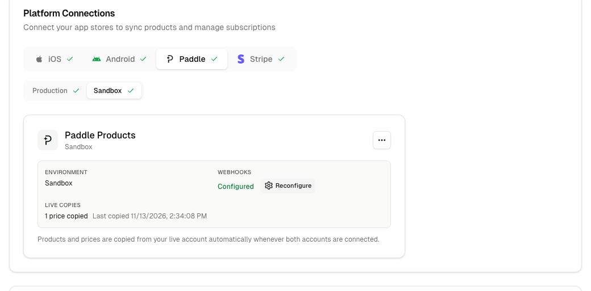
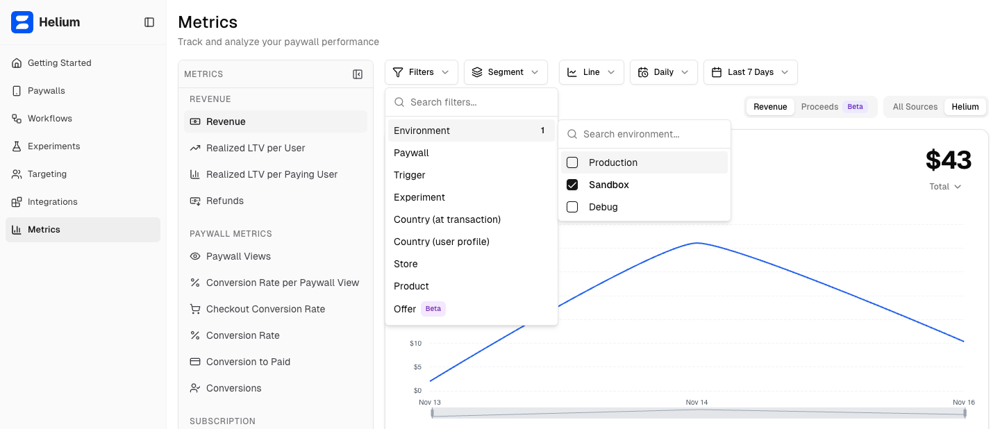
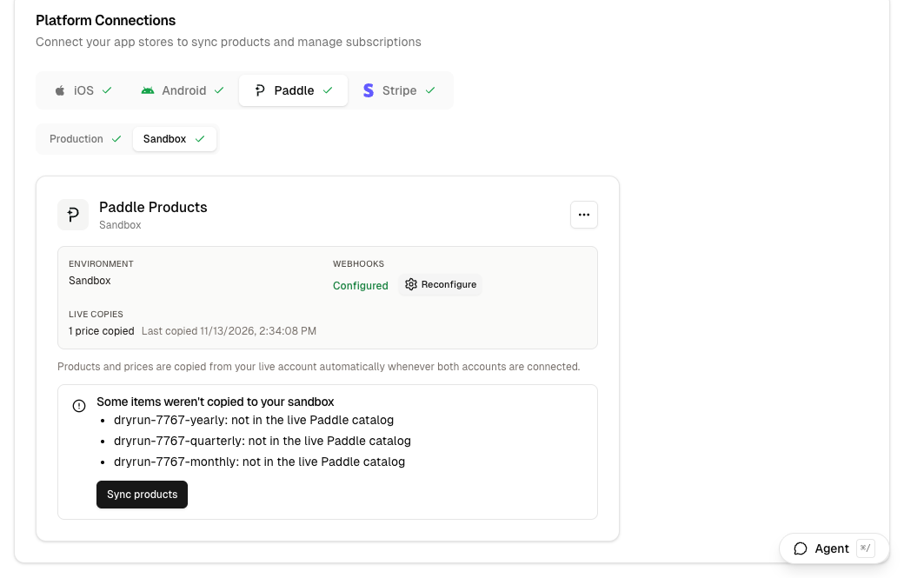
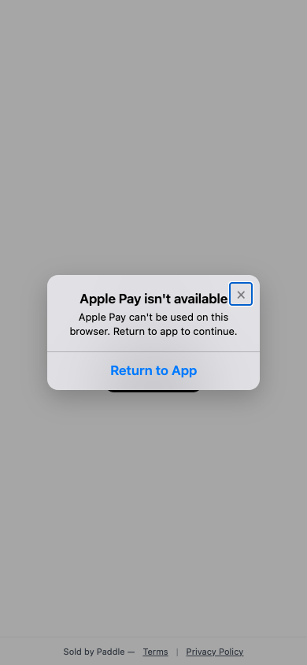
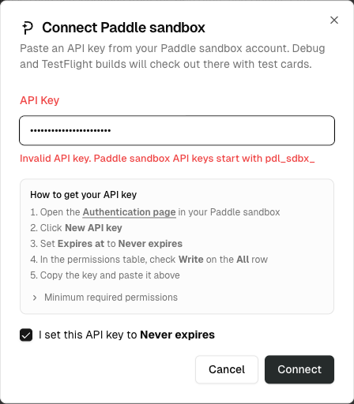
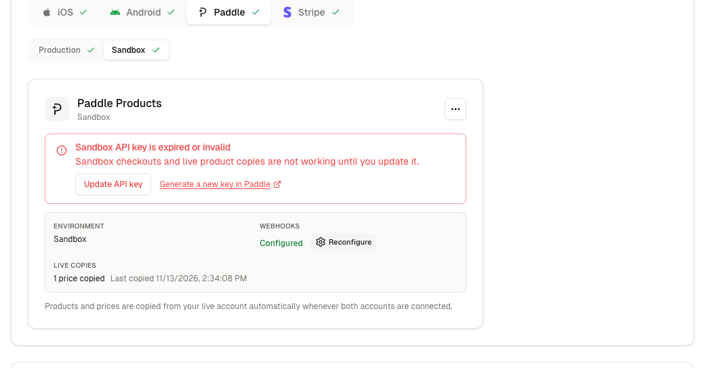

<Badge color="blue">iOS 4.15.0+</Badge> <Badge color="orange">React Native 3.1.15+</Badge> <Badge color="gray">Expo 3.6.6+</Badge> <Badge color="purple">Flutter 3.3.16+</Badge>

Buy your own App2Web subscription on a test build, from any country, without being charged. This guide takes you from connecting a Paddle sandbox account to running your first test purchase, checking that it worked, and testing again.

## Before you start

- [ ] Your live Paddle account is connected to Helium. If not, follow the [Paddle onboarding guide](/guides/paddle-onboarding-guide) first.
- [ ] Your app runs Helium iOS SDK 4.15.0 or later (React Native 3.1.15, Expo 3.6.6, Flutter 3.3.16).
- [ ] You have a [Paddle sandbox account](https://developer.paddle.com/build/tools/sandbox). It is free and separate from your live account.
- [ ] You have a physical iPhone with a card in Apple Wallet. The simulator cannot pay with Apple Pay.

Sandbox testing works on iOS only.

## How Helium picks the Paddle account

You don't change any code. Helium reads how the build was installed and picks the account for you.

| How the app was installed | Paddle account | Charged? |
|---|---|---|
| Run from Xcode, or the simulator | Sandbox | No |
| TestFlight, Firebase App Distribution, other ad hoc builds | Sandbox | No |
| App Store | Live | Yes |

This applies only when a sandbox account is connected. Without one, test builds check out on your live account and charge real money. If a sandbox account is connected but the build runs an older Helium SDK, the App2Web paywall is not shown on that build; see [Troubleshooting](#troubleshooting). Step 3 shows how to check which account a build uses.

The App Store build never uses your sandbox account. Your customers are never affected.

On a sandbox build, the US-only purchase rules are skipped. A tester in Mexico, Germany or anywhere else sees the App2Web paywall and can buy, with no VPN and no US App Store account.

Testers in California still see the consent modal when it's enabled, on both accounts.

## 1. Prepare your sandbox account

1. Open your [Paddle sandbox dashboard](https://sandbox-vendors.paddle.com).
2. Go to **Checkout settings**. Set a **Default payment link**. Any domain works in your sandbox account, no website approval needed.
3. On the same page, turn on **Apple Pay**.

## 2. Connect your sandbox account to Helium

1. In the Helium dashboard, open [**Integrations → Products → Paddle**](https://app.tryhelium.com/integrations/products).
2. Open the **Sandbox** tab and click **Connect Paddle sandbox**.
3. Follow the steps in the connect dialog to create your sandbox API key, then paste it and click **Connect**.

The key needs write permission; the dashboard rejects keys without it.

<Frame>
  
</Frame>

Use the same Helium organization as your live account. You don't need a separate app or organization for testing.

You'll know it worked when you see:

> Paddle sandbox connected & webhooks configured. Test builds pick this up within 30 seconds.

When you connect, Helium copies your live Paddle catalog into your sandbox account: every product you synced to Helium, with all its prices, trials and discounts. Copies are named `[Helium Live Copy] <product name>`.

Your paywalls keep pointing at your live products. On a sandbox build, Helium swaps in the copies at checkout. Code that checks for a specific product ID keeps working.

<Frame>
  
</Frame>

The Sandbox tab now shows **Webhooks: Configured** and **Live copies** with a count and a date.

After any catalog change in Paddle, such as a new price, a new trial or a removed discount, click **Sync products** on the **Production** tab before you test. Each live sync also refreshes the sandbox copies; they don't update on their own.

## 3. Show your App2Web paywall on a test build

Here are two examples of ways to show your App2Web paywall:

- **A test audience.** Create an audience with the `sandbox` or `debug` app environment and target your App2Web paywall to it. Leave out the **Paddle A2W Eligible** preset: it requires US users, and sandbox builds don't.
- **Paywall previews.** In your test build, [triple-tap any Helium paywall](/guides/paywall-previews#preview-paywalls-from-your-app) and pick your App2Web paywall. Choose **Sandbox purchase**, the default when a sandbox account is connected. Previews that include a Stripe checkout keep the [regional rules](/guides/app2web-previews#purchase-eligibility): outside the US they simulate the purchase and grant no entitlement.

Run the build from Xcode and look for this line in the console:

> [Helium] Paddle checkout on this build uses your sandbox account. No card is charged.

<Warning>
  If it says `uses your live account. Cards are charged.` instead, stop. That build charges real money. See [Troubleshooting](#troubleshooting).
</Warning>

You'll know it worked when the console names your sandbox account and the App2Web paywall appears.

## 4. Make a test purchase

1. On your iPhone, open the trigger that shows your App2Web paywall, or the paywall you picked in Paywall previews, and tap through to the web checkout.
2. Check the banner at the top of the checkout. It reads “Sandbox checkout. Your card is not charged.”
3. Pay with Apple Pay using your real card. Sandbox Apple Pay payments are [not charged](https://developer.paddle.com/concepts/payment-methods/apple-pay).
4. Return to the app.

<Frame>
  
</Frame>

You'll know it worked when you're back in the app with access unlocked.

While you're here, also try:

- **Trials and discounts.** If the product has a trial or a discount, check that the checkout shows it.
- **Cancel the checkout.** Close it and check that the app returns to the paywall without granting access.
- **Manage subscription.** Open the customer portal, cancel, and check that access lasts until the period ends.

## 5. Check that it worked

- **In your app.** `hasActivePaddleEntitlement()` returns `true`. `purchasedProductIds()` reports your live product and price IDs, not the copies, so your existing checks work.
- **In Paddle.** In your sandbox dashboard, open **Developer tools → Notifications**. Deliveries to Helium return 2xx.
- **In Helium.** Metrics show production data by default. Open **Filters → Environment** and select **Sandbox** to see your test purchase.

<Frame>
  
</Frame>

Using RevenueCat or your own entitlement system? Connect it to your Paddle sandbox account too. Helium only sets up its own webhook.

## 6. Test again

An active sandbox subscription keeps you subscribed on test builds until it ends. To test again:

1. In your Paddle sandbox dashboard, open [**Subscriptions**](https://sandbox-vendors.paddle.com/subscriptions-v2) and cancel the test subscription **immediately**, not at the end of the billing period. Access stays active until the subscription ends.
2. Open the trigger again.

Sandbox purchases never reach your live Paddle account, and your App Store build never sees them.

<Warning>
  Keep your sandbox account connected between rounds. If you disconnect it, debug and TestFlight builds go back to your live account and charge real money. Your live connection and products are not affected.
</Warning>

## Before you submit for App Review

App Review runs your build in the `sandbox` app environment, the same as TestFlight. An audience on the `sandbox` app environment with no other condition reaches the reviewers too, and they see your App2Web paywall. Before you submit, turn the test audience off, or add a user ID condition so it matches only your testers.

## Troubleshooting

Each message below is what you see in the Xcode console, the paywall diagnostic, or the dashboard.

### The App2Web paywall doesn't show

> This paywall sells a Paddle price that has no copy in your sandbox account. In the Helium dashboard, open Integrations → Products → Paddle → Sandbox and click Sync products.

Do what it says. Then check the Sandbox tab for items that could not be copied.

<Frame>
  
</Frame>

> Debug and TestFlight builds use your Paddle sandbox account, and this requires a newer Helium SDK version. Update to the latest Helium SDK.

Update the SDK to the versions in [Before you start](#before-you-start).

> Paddle App-to-Web checkout is only available in the US. This device's IP country is not US. Connect a Paddle sandbox account to check out from any country on debug and TestFlight builds.

The build has no sandbox account, so it uses your live account and its US-only rules. Go back to [step 2](#2-connect-your-sandbox-account-to-helium).

> The Paddle sandbox account can't be read. Please reconnect it in the Helium dashboard.

Disconnect and connect your sandbox account again on the Sandbox tab.

Still nothing? Check that your audience doesn't include the **Paddle A2W Eligible** preset, and that the build isn't from the App Store.

### The checkout says Apple Pay isn't available

<Frame>
  
</Frame>

> Apple Pay isn't available
>
> Apple Pay can't be used on this browser. Return to app to continue.

You're on the simulator, a desktop browser, or an iPhone with no card in Wallet. Use a physical iPhone with a card.

> Apple Pay is not turned on in your Paddle sandbox account. Turn it on under Checkout settings, then try again.

Turn on Apple Pay in [step 1](#1-prepare-your-sandbox-account), then try again.

### The dashboard rejects your key

<Frame>
  
</Frame>

> Invalid API key. Paddle sandbox API keys start with pdl_sdbx_

You pasted a live key. Create a key in your sandbox dashboard instead.

> This key cannot write to your Paddle sandbox account. Create a key with Write on the All row.

Follow the key-creation steps in the Sandbox connect dialog, as in [step 2](#2-connect-your-sandbox-account-to-helium).

### The Sandbox tab says your key expired

<Frame>
  
</Frame>

> Sandbox API key is expired or invalid

Sandbox checkouts and product copies stop until you replace the key. Create a new key in the same sandbox account, set to never expire, and click **Update API key**.

### Web checkout needs a custom user ID

Web checkout requires a user ID from your app unless you set `allowWebCheckoutWithoutUserId` to `true`. Set a user ID before opening the paywall. See [Add web checkout to your app](/guides/paddle-onboarding-guide#5-add-web-checkout-to-your-app).

### Cancelling opens App Store subscriptions instead of Paddle

Your app sent a Paddle subscriber to App Store subscription management. When `hasActivePaddleEntitlement()` returns `true`, open the Paddle customer portal instead, as in the Manage Subscription button from [Add web checkout to your app](/guides/paddle-onboarding-guide#5-add-web-checkout-to-your-app).

## Next steps

- Test any App2Web paywall from the triple-tap menu with [App2Web Paywall Previews](/guides/app2web-previews).
- Run the [App2Web Go-Live Checklist](/guides/app2web-go-live-checklist) before you roll out to customers.
- Find answers on attribution, experiments and entitlements in the [App2Web FAQ](/guides/app2web-faq).
