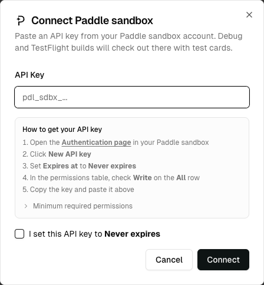
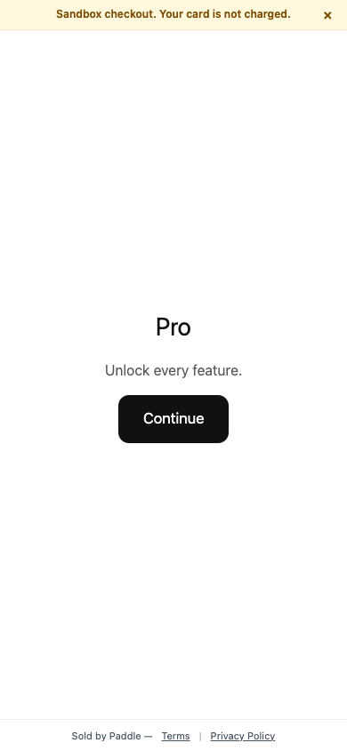

<Badge color="blue">iOS 4.15.0+</Badge> <Badge color="orange">React Native 3.1.15+</Badge> <Badge color="gray">Expo 3.6.6+</Badge> <Badge color="purple">Flutter 3.3.16+</Badge>

Connect a Paddle sandbox account once, then buy your own App2Web subscription on a test build, from any country, without being charged.

## Before you start

- [ ] Your live Paddle account is connected to Helium. If not, follow the [Paddle onboarding guide](/guides/paddle-onboarding-guide) first.
- [ ] Your app runs Helium iOS SDK 4.15.0 or later (React Native 3.1.15, Expo 3.6.6, Flutter 3.3.16).
- [ ] You have a [Paddle sandbox account](https://developer.paddle.com/build/tools/sandbox). It is free and separate from your live account.
- [ ] You have a physical iPhone with a card in Apple Wallet. The simulator cannot pay with Apple Pay.

## How Helium picks the Paddle account

You don't change any code. Helium picks the account from how the build was installed:

| How the app was installed | Paddle account | Charged? |
|---|---|---|
| Run from Xcode, or the simulator | Sandbox | No |
| TestFlight | Sandbox | No |
| App Store | Live | Yes |

- Test builds use your sandbox account only while one is connected. Without one, they use your live account, charge real money and follow the US-only purchase rules.
- App Store builds never use your sandbox account, so your customers are never affected.
- Sandbox builds skip the US-only purchase rules: testers in any country can buy, with no VPN or US App Store account. The California consent modal still shows when it's enabled.

### Test the live checkout from a test build

To check out on your live Paddle account from a debug or TestFlight build, call `Helium.testing.useLiveWebCheckoutAccount()` before you initialize Helium. This requires a Helium iOS SDK release later than 4.15.0.

```swift
// Must run before initialize; later calls are ignored
Helium.testing.useLiveWebCheckoutAccount()
Helium.shared.initialize(apiKey: "<your-helium-api-key>")
```

The account stays fixed until the app relaunches, including after `Helium.resetHelium()`. A call made after `initialize` is ignored and logs a warning. To test sandbox and live checkouts separately, distribute a separate TestFlight build for each. The setting applies to Paddle only: Stripe web checkout always uses your connected Stripe account.

In the triple-tap preview settings, the **Real purchase** description names the Paddle account the session checks out on.

## 1. Prepare your sandbox account

1. Open your [Paddle sandbox dashboard](https://sandbox-vendors.paddle.com).
2. Go to **Checkout settings**. Set a **Default payment link**. Any domain works in your sandbox account, no website approval needed.
3. On the same page, turn on **Apple Pay**.

## 2. Connect your sandbox account to Helium

1. In the Helium dashboard, open [**Integrations → Products → Paddle**](https://app.tryhelium.com/integrations/products).
2. Open the **Sandbox** tab and click **Connect Paddle sandbox**.
3. Follow the steps in the connect dialog to create your sandbox API key, then paste it and click **Connect**.

The key needs write permission; the dashboard rejects keys without it.

<Frame>
  
</Frame>

**You don't need to create sandbox products or prices yourself. Helium automatically creates matching sandbox copies of your production products and prices.** It copies every product you synced to Helium, with its prices, trials and discounts, named `[Helium Live Copy] <product name>`. Your paywalls keep pointing at your live products; sandbox builds use the copies at checkout.

<Frame>
  
</Frame>

After you change your catalog in Paddle, click **Sync products** on the **Production** tab before you test. This also refreshes the sandbox copies.

Using RevenueCat or your own entitlement system? Connect it to your Paddle sandbox account too, before you test. Helium only sets up its own webhook, so otherwise access won't unlock in your system after a purchase. For RevenueCat, import the sandbox copies and attach them to your entitlements, as in the [RevenueCat setup](/guides/paddle-onboarding-guide#6-configure-your-entitlements).

## 3. Show your App2Web paywall on a test build

Two ways to show it:

- **A test audience.** Create an audience with the `sandbox` or `debug` app environment and target your App2Web paywall to it. Leave out the **Paddle A2W Eligible** preset: it requires US users, and sandbox builds don't.
- **Paywall previews.** In your test build, [triple-tap any Helium paywall](/guides/paywall-previews#preview-paywalls-from-your-app) and pick your App2Web paywall. Choose **Sandbox purchase**, the default when a sandbox account is connected. Previews that include a Stripe checkout keep the [regional rules](/guides/app2web-previews#purchase-eligibility).

## 4. Make a test purchase

1. On your iPhone, open your App2Web paywall, from your app or from Paywall previews, and tap through to the web checkout.
   Close the checkout once and check that the app returns to the paywall without granting access, then open it again.
2. Check for the banner at the top of the checkout saying purchases go through your Paddle sandbox account. If there's no banner, stop: that checkout uses your live account and charges real money. See [Troubleshooting](#troubleshooting).
3. Pay with Apple Pay using your real card. Sandbox Apple Pay payments are [not charged](https://developer.paddle.com/concepts/payment-methods/apple-pay).
4. Return to the app.

<Frame>
  
</Frame>

## 5. Check that it worked

1. **Use your app.** Check that the purchase unlocks the right entitlement tier and the features you expect.
2. **Check the SDK.** `hasActivePaddleEntitlement()` returns `true`, and `purchasedProductIds()` reports your live product and price IDs, not the copies.
3. **Check webhooks.** In your sandbox dashboard, open **Developer tools → Notifications**. Deliveries to Helium return 2xx.

Also check that any trial or discount showed on the checkout.

## 6. Test cancellation

Before you start, ask Helium support to enable sandbox subscription management for your organization. Without it, the portal doesn't list your test subscription.

1. Check that your [**Manage Subscription** button](/guides/paddle-onboarding-guide#5-add-web-checkout-to-your-app) shows only while the user has an active Paddle subscription.
2. Tap it on your test build. It opens your Paddle sandbox account's customer portal. Check that your test subscription is listed.
3. Cancel the subscription, walking through every screen, including any retention offers you set up.
4. A cancellation at the end of the billing period [keeps access until then](/guides/app2web-faq#cancellation). Return to your app and check that access is still active.

To end access right away and retest, open [**Subscriptions**](https://sandbox-vendors.paddle.com/subscriptions-v2) in your Paddle sandbox dashboard and cancel the test subscription **immediately**.

<Note>
  **How Manage Subscription picks the account:** When your button uses `createPaddlePortalSession()`, Helium picks the portal the same way it picks checkout: test builds (debug, TestFlight or sandbox) open your sandbox account's portal; App Store builds open your live account's portal. Subscribers on your live account never see sandbox subscriptions, and the other way around.

  If your backend generates [pre-authenticated portal links](/guides/paddle-onboarding-guide#5-add-web-checkout-to-your-app), it picks the account: use your sandbox API key for test builds.
</Note>

<Accordion title="Want to test again?">
  An active sandbox subscription keeps you subscribed on test builds. In your Paddle sandbox dashboard, open [**Subscriptions**](https://sandbox-vendors.paddle.com/subscriptions-v2) and cancel the test subscription **immediately**, then make another test purchase.

  Keep your sandbox account connected between rounds. If you disconnect it, test builds go back to your live account and charge real money.
</Accordion>

## Troubleshooting

If the App2Web paywall doesn't show or checkout has no sandbox banner, check:

- Your sandbox account is connected on the **Sandbox** tab ([step 2](#2-connect-your-sandbox-account-to-helium)). If its key expired or was revoked, replace it with **Update API key**.
- Your app runs the SDK versions listed [at the top](#before-you-start); older SDKs don't show the App2Web paywall on test builds while a sandbox is connected.
- Every Paddle price on the paywall has a sandbox copy; run **Sync products** on the **Production** tab.
- You're using a debug or TestFlight build, not an App Store build.
- You're using a physical iPhone with a card in Wallet for Apple Pay.

## Next steps

- Test any App2Web paywall from the triple-tap menu with [App2Web Paywall Previews](/guides/app2web-previews).
- Run the [App2Web Go-Live Checklist](/guides/app2web-go-live-checklist) before you roll out to customers.
- Find answers on attribution, experiments and entitlements in the [App2Web FAQ](/guides/app2web-faq).
