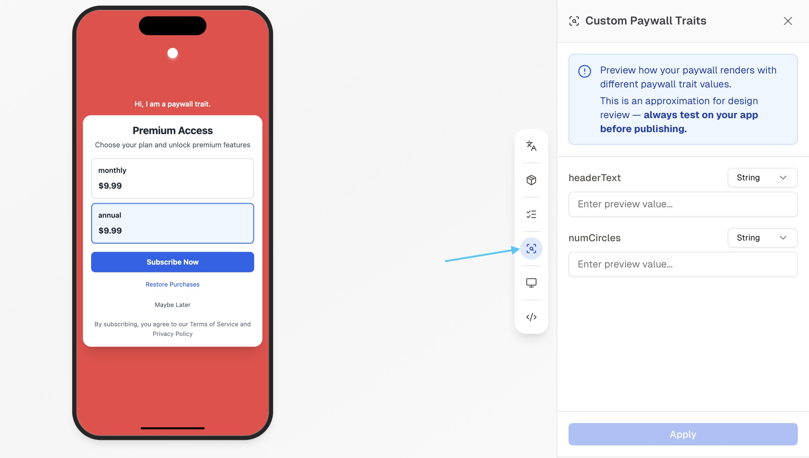

<Badge color="blue">iOS 4.4.2+</Badge> <Badge color="green">Android 4.4.2+</Badge> <Badge color="orange">React Native 3.4.3+</Badge> <Badge color="purple">Flutter 3.3.3+</Badge>

Paywall traits are values passed into a paywall upon presentation, allowing your paywall to display or behave differently depending on those values.

This must be configured in two places:

1. Your paywall via the paywall editor
2. Your app by passing in values to the Helium mobile SDK

## Paywall Editor

<Frame>
  
</Frame>

Open the paywall editor from the [Helium dashboard](https://app.tryhelium.com/paywalls). Type something like

```text
use a paywall trait with key "name" to display a customized greeting
```

<Warning>
  You MUST provide a **default value** or behavior for each trait, in case the app does not pass in a value.
</Warning>

## Pass in from the SDK

By default, user traits will automatically be included as custom paywall traits in all of your paywalls. (Just make sure your SDK version is higher than what's listed at the top of this page.)

To pass in additional paywall traits during paywall presentation, use the `customPaywallTraits` parameter.

<CodeGroup>

```swift iOS
Helium.shared.presentPaywall(
    trigger: "your-trigger",
    config: PaywallPresentationConfig(
        customPaywallTraits: HeliumUserTraits(["name": nameValue])
    )
) { paywallNotShownReason in }
```

```kotlin Android
import com.tryhelium.paywall.core.HeliumUserTraits.Companion.create

Helium.presentPaywall(
    "your-trigger",
    config = PaywallPresentationConfig(
        customPaywallTraits = mapOf(
            "name" to nameValue,
        ).create()
    )
)
```

```tsx React Native
presentUpsell({
  triggerName: "your-trigger",
  customPaywallTraits: { name: nameValue },
});
```

```dart Flutter
await HeliumFlutter().presentUpsell(
  context: context,
  trigger: "your-trigger",
  customPaywallTraits: { "name": nameValue },
);
```

</CodeGroup>

## Targeting and Metrics Considerations

If you want to evaluate the effects of different traits in your paywall, utilize user traits in your SDK integration.

Helium does not currently support the use of`customPaywallTraits` (passed during paywall presentation) as metrics filters.

User traits can also be used for targeting.

### **What if I set both?**

If the same key is present in both user traits and `customPaywallTraits`, the paywall will see the value from `customPaywallTraits`.

Metrics still only sees the value from user traits.

## Built-in Traits

The iOS SDK passes built-in traits into every paywall. Your paywall can use them to react to what the user already owns, with no extra code in your app. For example, a plan-change paywall can highlight the user's current plan or hide products they already have.

To use a built-in trait, reference its key in the paywall editor the same way you reference a custom trait:

| Key | Type | Value |
| --- | --- | --- |
| `hlm_hasActiveAppStoreSubscription` | Boolean | `true` when the user has an active auto-renewable App Store subscription. |
| `hlm_activeAppStoreProductIds` | Array of strings | App Store product IDs of the user's active purchases, including non-consumables and active subscriptions. |
| `hlm_hasActivePaddleSubscription` | Boolean | `true` when the user has an active Paddle subscription. Only included when Paddle is set up. |
| `hlm_activePaddleProductIds` | Array of strings | Active Paddle purchases, each in `productId:priceId` format. Only included when Paddle is set up. |

The SDK reads these values from the entitlements it has already cached, so they don't add network requests or delay the paywall. Before StoreKit finishes loading on a new launch, the App Store values come from the entitlements saved during the previous session.

If a user trait or `customPaywallTraits` uses the same key as a built-in trait, the paywall sees your value instead of the built-in one.

<Note>
  Built-in traits are available in the iOS SDK only.
</Note>