Start with a flow, pick one thing to improve, and test it against what you run today. These are patterns we use with customers—not promises that every variant will win.

## Four flows to start with

Pick the shortest flow that explains your offer well. Keep your own branding, product promise, and plan names throughout.

*The Helium Pro images below are layout templates. Replace sample prices, claims, and testimonials with your own; reconcile trial labels and renewal terms before shipping.*

<AccordionGroup>
  <Accordion title="Single-page toggle → checkout page">
    **Flow:** choose an offer on one page → continue to a compact web checkout page → payment sheet.

    **Why try it:** less repeated selling between deciding to buy and paying. Useful when your first page already explains the benefits and plans clearly.

    Keep the selected offer consistent through the handoff. The checkout page still needs the full price, trial terms, and renewal cadence.

    **Watch:** handoff-to-purchase conversion. A shorter page can help speed, but may need more reassurance if users hesitate in the browser.

    <Accordion title="Example: keep the browser checkout compact">
      <Frame>
        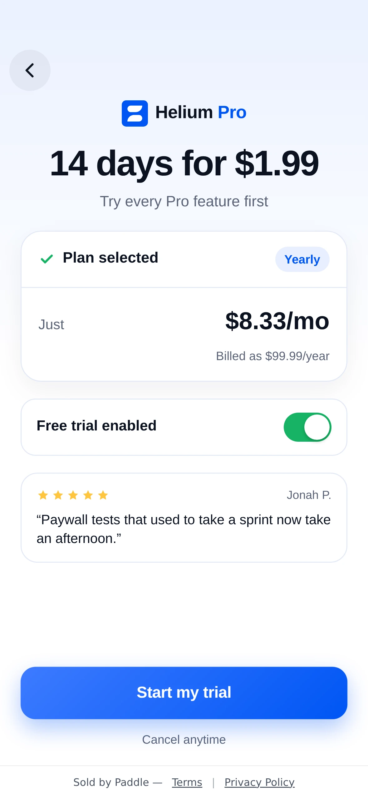
      </Frame>

      **Notice:** one selected-plan card, a trial switch directly below it, and one bottom CTA. The Back button gives users a way out without competing with the purchase action.

      Borrow the compact structure for the destination after your in-app toggle. This template shows that destination, not the preceding toggle. Its “free trial” label conflicts with the paid introductory headline—use one consistent offer in your version.
    </Accordion>
  </Accordion>

  <Accordion title="Single-page toggle → matching web paywall">
    **Flow:** choose an offer → open a web paywall that looks like the page you just left → payment sheet.

    **Why try it:** visual continuity. The browser feels like the same product instead of an unfamiliar checkout.

    Match the artwork, headline, plan names, and selected offer. Keep the web page focused on one purchase CTA rather than asking users to make the same decision again.

    **Watch:** whether familiarity outweighs the extra page and tap.

    <Accordion title="Example: carry the same benefits into the browser">
      <Tabs>
        <Tab title="Overview">
      <Frame>
        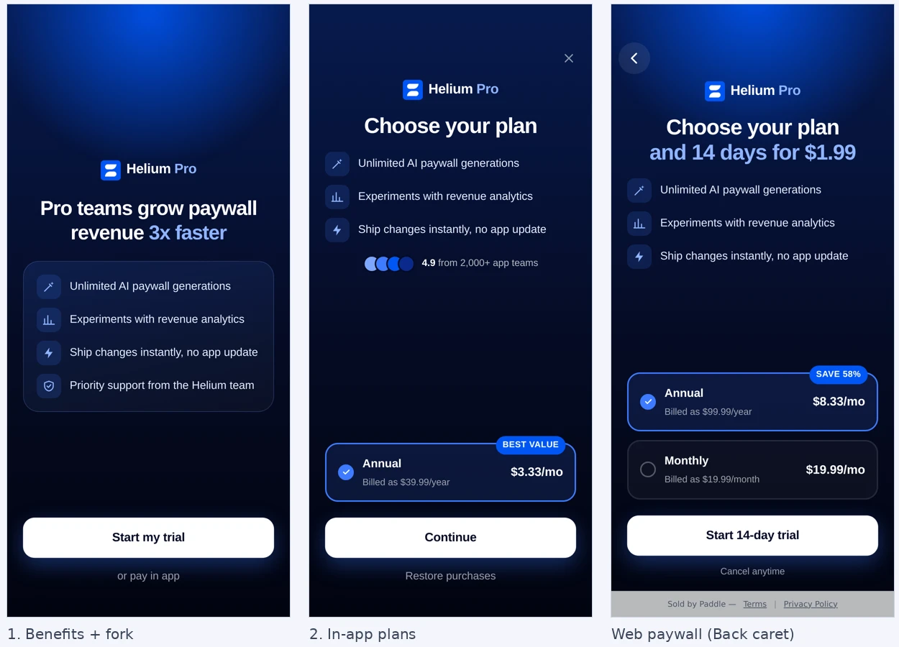
      </Frame>
        </Tab>
        <Tab title="Intro">
          <Frame>
            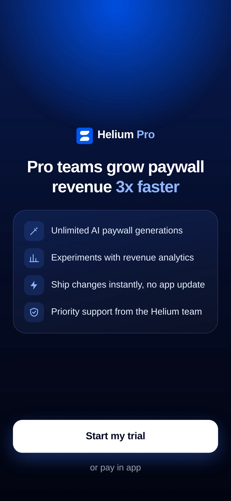
          </Frame>
        </Tab>
        <Tab title="In-app">
          <Frame>
            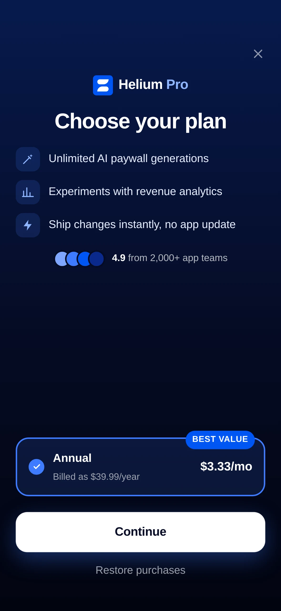
          </Frame>
        </Tab>
        <Tab title="Web">
          <Frame>
            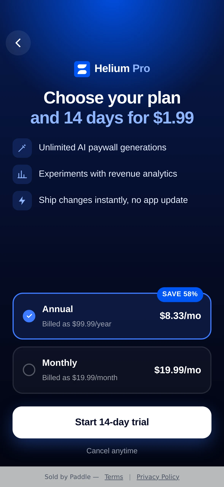
          </Frame>
        </Tab>
      </Tabs>

      **Notice:** the IAP and web pages reuse the dark palette, logo position, benefit list, and annual-plan emphasis. The web headline adds the introductory offer instead of starting a new sales pitch.

      The first screen has a primary trial CTA and a smaller **“or pay in app”** link. These are alternative routes; users do not visit every screen in the strip. Borrow the visual continuity for a toggle-led flow too.
    </Accordion>
  </Accordion>

  <Accordion title="Three-page flow with a secondary CTA">
    **Flow:** benefit or trial intro → reminder page → final offer. Keep the primary CTA in the same place as users advance.

    On the page before the final offer, the primary CTA opens web; a smaller **“or pay in app”** CTA opens the IAP paywall. Each route ends with its own purchase screen.

    **Why try it:** explain the value and trial before asking for payment, with a consistent rhythm of taps and a clear in-app alternative.

    **Watch:** completion through each step. Extra pages should resolve a question or add confidence—not just make the flow longer.

    <Accordion title="Example: intro → reminder → offer">
      <Tabs>
        <Tab title="Overview">
      <Frame>
        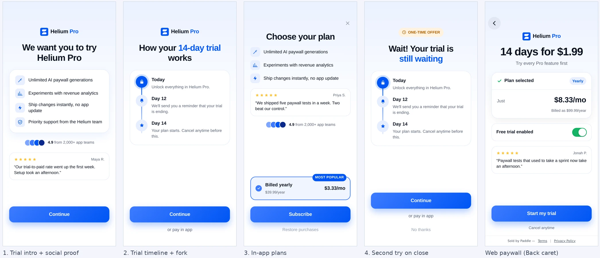
      </Frame>
        </Tab>
        <Tab title="Intro">
          <Frame>
            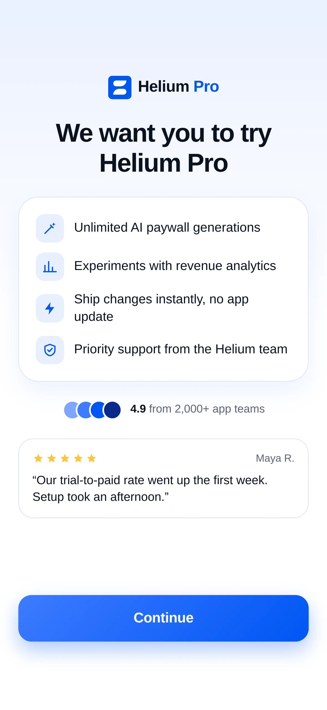
          </Frame>
        </Tab>
        <Tab title="Reminder">
          <Frame>
            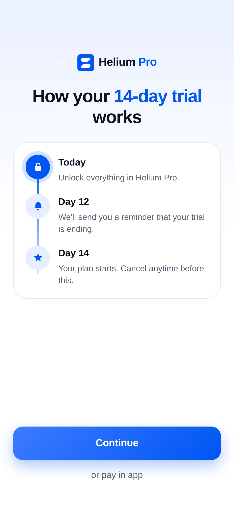
          </Frame>
        </Tab>
        <Tab title="In-app">
          <Frame>
            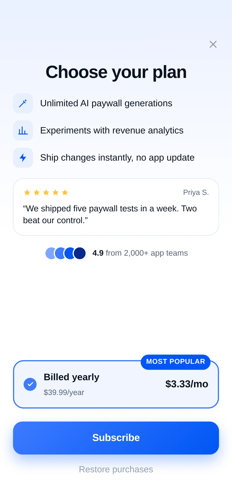
          </Frame>
        </Tab>
        <Tab title="Second offer">
          <Frame>
            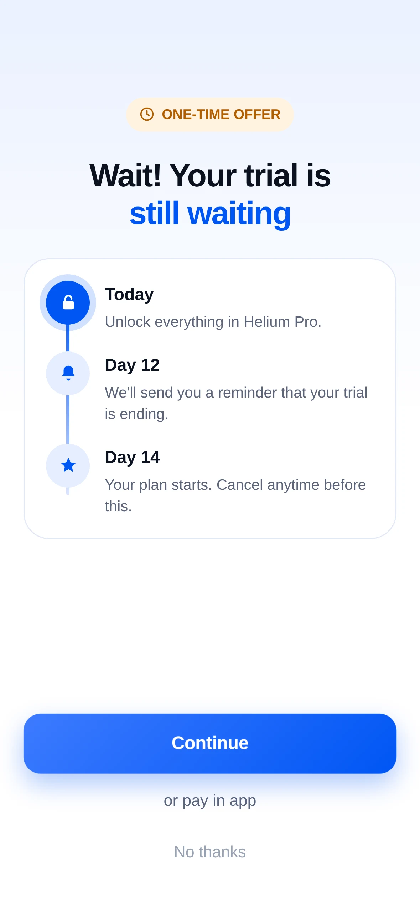
          </Frame>
        </Tab>
        <Tab title="Web">
          <Frame>
            
          </Frame>
        </Tab>
      </Tabs>

      **Notice:** the blue CTA stays near the bottom as the content changes. The reminder page turns the offer into **Today → reminder day → billing day**, with **“or pay in app”** immediately beneath the main button.

      The strip also shows the alternative IAP page, a second-try page, and web checkout—not five mandatory steps. Keep the reminder promise tied to a reminder you actually send.
    </Accordion>
    <Accordion title="Example: a shorter flow with a secondary CTA">
      <Tabs>
        <Tab title="Overview">
      <Frame>
        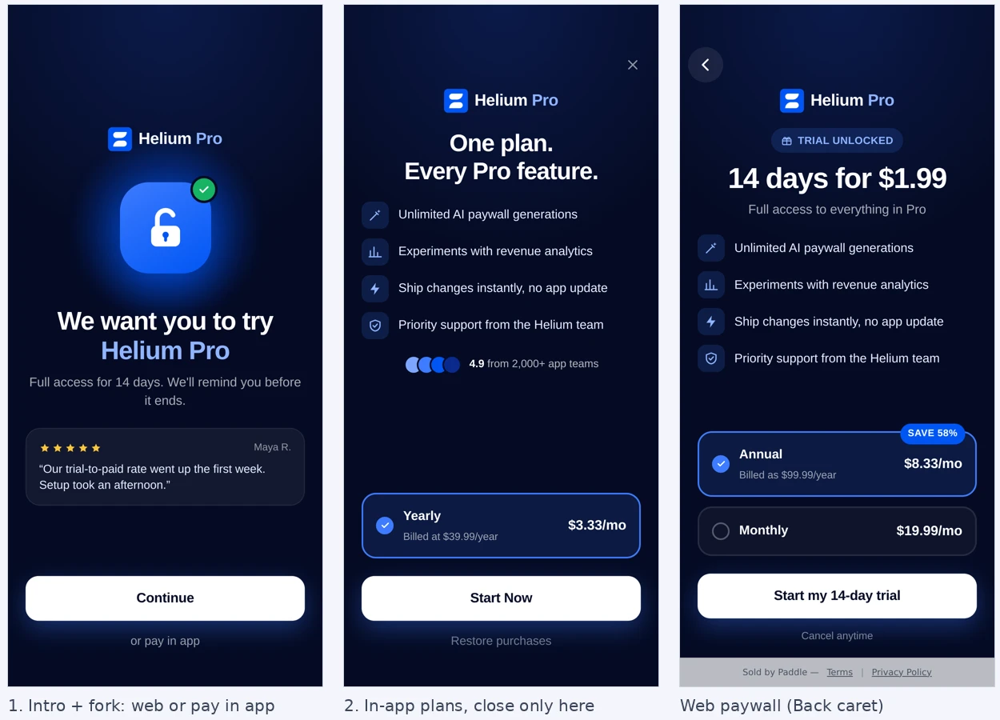
      </Frame>
        </Tab>
        <Tab title="Intro">
          <Frame>
            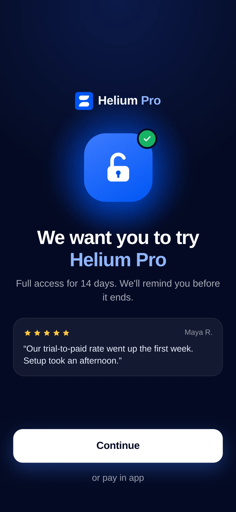
          </Frame>
        </Tab>
        <Tab title="In-app">
          <Frame>
            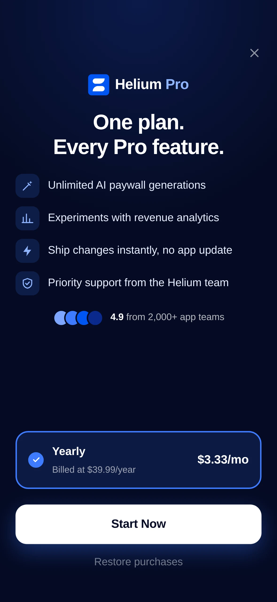
          </Frame>
        </Tab>
        <Tab title="Web">
          <Frame>
            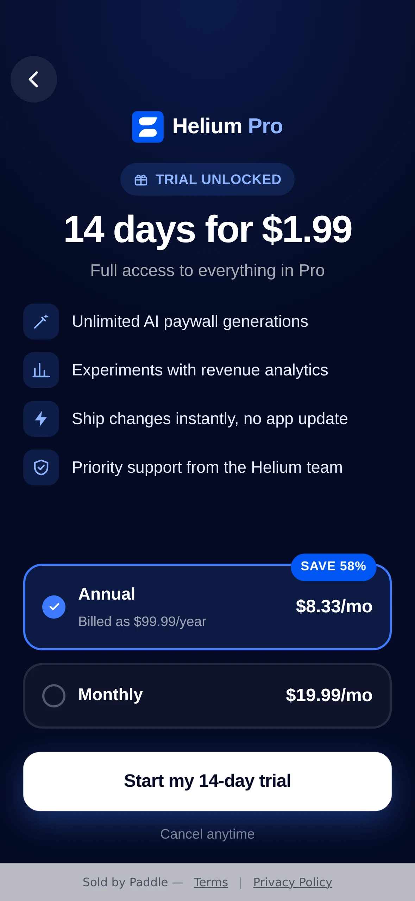
          </Frame>
        </Tab>
      </Tabs>

      **Notice:** the introduction sells the trial with a single illustration and short testimonial. A full-width **Continue** button is paired with a quiet **“or pay in app”** link.

      One choice page leads to either IAP plans or web checkout. The secondary CTA chooses the route; there is no toggle. The web destination gives the introductory offer the headline.
    </Accordion>
  </Accordion>

  <Accordion title="Put the toggle on the page before the paywall">
    **Flow:** trial or offer-selection page → the appropriate web or IAP paywall → purchase.

    **Why try it:** separate choosing an offer from choosing a plan. This is useful when web has a trial and IAP does not.

    Label exactly what the choice changes. Do not make flipping a switch unexpectedly launch the browser; let the CTA perform the handoff.

    <Note>
      Toggle layouts are reference patterns, not a blanket recommendation to add a web-opening trial toggle to a final IAP paywall. Confirm the in-app implementation for your storefront and App Review requirements before shipping.
    </Note>
  </Accordion>
</AccordionGroup>

| Your goal | Start here |
| --- | --- |
| Choose a layout | [Four flows to start with](#four-flows-to-start-with) |
| Move more purchases to web | [Make the web offer more compelling](#get-more-people-to-check-out-on-web) |
| Turn more visitors into subscribers | [Improve your web paywall](#increase-your-conversion-rate) |
| Recover people who leave checkout | [Try a second offer](#give-web-checkout-a-second-try) |
| Improve the whole journey | [Before and after the paywall](#improve-the-whole-flow) |

<Accordion title="Before you ship: pricing disclosures and in-app restrictions">
<Warning>
Many of the web design ideas below aren’t allowed on in-app purchase paywalls. Treat web and IAP as separate surfaces; a reference screenshot is not an App Review approval.

**You must clearly show the price the user will be charged, when they will be charged, and that the subscription automatically renews on a specific cadence.** Keep this readable on the purchase screen, not hidden in a toggle or left only to the payment sheet.

For example: **“7 days free, then $59.99/year. Automatically renews annually until canceled.”** Show any applicable tax treatment clearly. A monthly equivalent never replaces the actual annual charge. See [Apple’s subscription guidance](https://developer.apple.com/app-store/subscriptions/) for IAP requirements.
</Warning>
</Accordion>

## Get more people to check out on web

Optimize **web purchase share and total conversion together**. Moving existing buyers to web is useful only if the overall economics improve.

<AccordionGroup>
  <Accordion title="Try raising in-app prices by 15%">
    Keep the web price unchanged and test a roughly 15% higher IAP price using an available store price point. For example, compare a $59.99 web offer with an IAP price near $68.99, where available.

    **Why:** gives customers a concrete reason to choose web while keeping an in-app option.

    <Accordion title='Example: “Want 15% off?” toggle'>
      <Columns cols={2}>
        

          **Toggle off: in-app prices**
          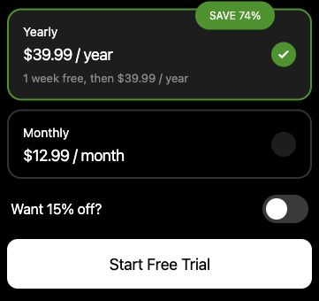
        

        

          **Toggle on: web prices**
          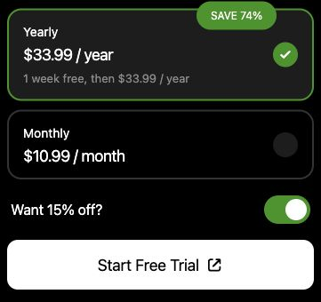
        

      </Columns>

      The toggle updates the displayed prices and routes the CTA to web checkout. Here, the annual price changes from $39.99 to $33.99.

      *Captured from the paywall’s exported source; cropped to the offer controls to omit app identity.*

      A 15% web discount and a 15% IAP price increase are different tests—calculate the savings from the actual prices you ship.
    </Accordion>

    **Measure:** web purchase share, total paid conversion, and proceeds per user. Higher proceeds per purchase can be offset by fewer buyers. Apply the experiment to the intended new-purchase cohort; don’t silently change existing subscribers’ pricing.
  </Accordion>

  <Accordion title="Offer the trial on web; keep IAP as a paid option">
    Keep a free trial on the web route and use non-trial products on the in-app route. The purchase CTA and billing copy must update to match the selected route.

    **UI variants to test:**

    - A trial-choice page before the paywall.
    - A clear **“View trial options”** button leading to the web offer.
    - A trial-reminder page with a primary web CTA and secondary **“or pay in app.”**

    <Accordion title="Example: keep the introductory offer on web">
      <Tabs>
        <Tab title="Overview">
      <Frame>
        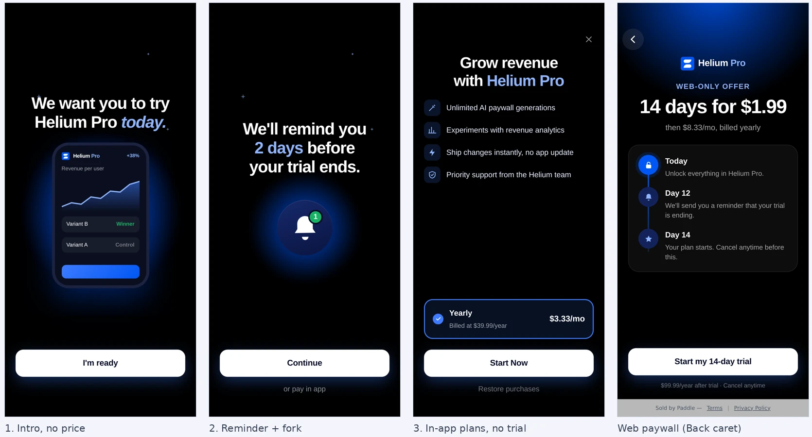
      </Frame>
        </Tab>
        <Tab title="Intro">
          <Frame>
            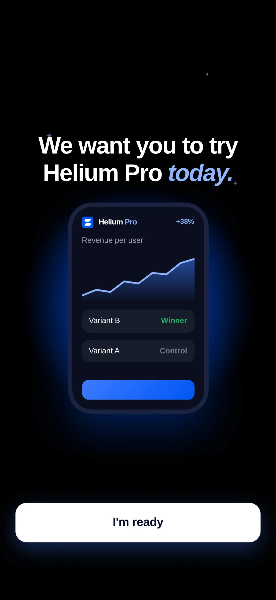
          </Frame>
        </Tab>
        <Tab title="Reminder">
          <Frame>
            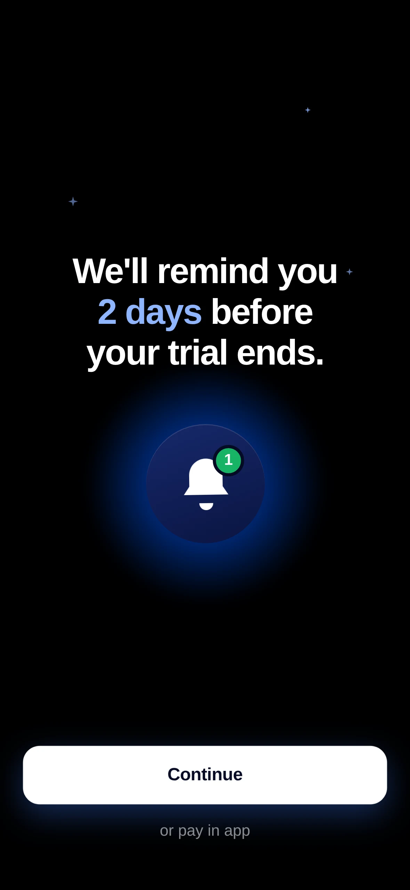
          </Frame>
        </Tab>
        <Tab title="In-app">
          <Frame>
            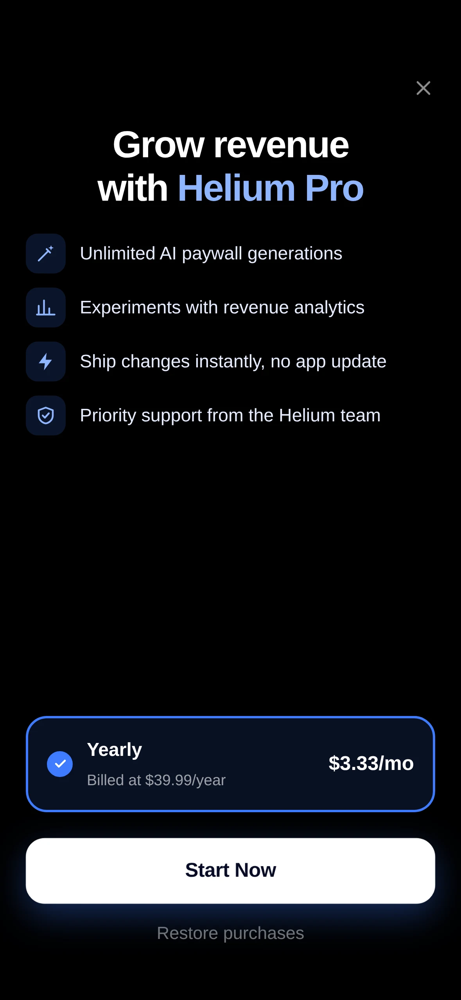
          </Frame>
        </Tab>
        <Tab title="Web">
          <Frame>
            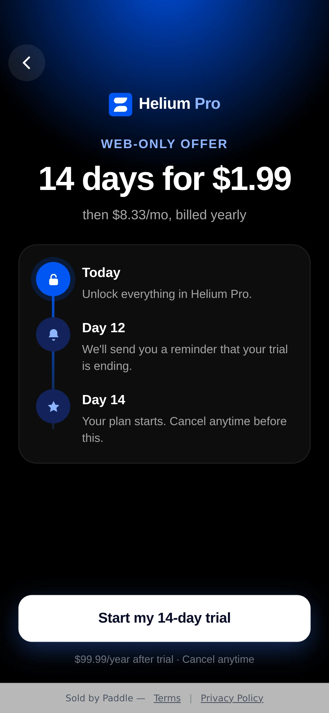
          </Frame>
        </Tab>
      </Tabs>

      **Notice:** the intro shows the product before showing a price. The next page puts **“2 days before”** at the center of the reminder promise and introduces the secondary in-app route.

      The IAP branch has a straightforward **Start Now** button with no trial. **That in-app paywall has no secondary CTA back to the web offer. We recommend adding something like “View trial options.”** Experiment with how prominent it is: a subtle text link, a secondary button, or a more visible trial callout.

      The web branch explains the introductory period with a timeline. This template uses a paid introductory offer; the same routing pattern can use a genuinely free web trial.
    </Accordion>

    **Why:** the web route offers something users value beyond a different payment method.

    **Measure:** trial starts first, then trial-to-paid conversion and proceeds per user once those trials mature. Don’t compare trial starts on web with paid purchases in app as if they were the same outcome.
  </Accordion>

  <Accordion title="Test the web CTA’s copy and prominence">
    Try **“or pay in app”** instead of **“or continue in app”** for the secondary route. Test a larger primary web CTA, a clearer trial benefit, or a savings message based on the actual offers.

    Keep the alternative easy to find, and make it clear when users are choosing a different offer. Test one change at a time so you know what caused the result.
  </Accordion>

  <Accordion title="Test what users see when they return without buying">
    You can change the in-app paywall state after its web-product purchase action opens the browser. This is a **handoff**, not proof that a purchase succeeded.

    | Return experience | What you’re testing |
    | --- | --- |
    | Show the IAP paywall | Can recover users who prefer paying in app and may slightly increase total conversion. |
    | Keep the page with the web option | Makes another web attempt easy and may increase the share of purchases completed on web. |
    | Show a different page or offer | Can address the reason for hesitation, such as plan length or price. |

    **How to set it up:** ask the Helium paywall editor to preserve the web-choice page or prepare the IAP/alternate page after the handoff. Have your app check the purchase result and entitlements when the user returns. Only show the recovery experience if they have not bought; successful buyers should get access, not another sales pitch.

    <Accordion title="Example: change the offer after hesitation">
      <Tabs>
        <Tab title="Overview">
      <Frame>
        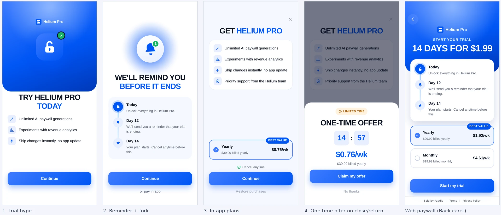
      </Frame>
        </Tab>
        <Tab title="Intro">
          <Frame>
            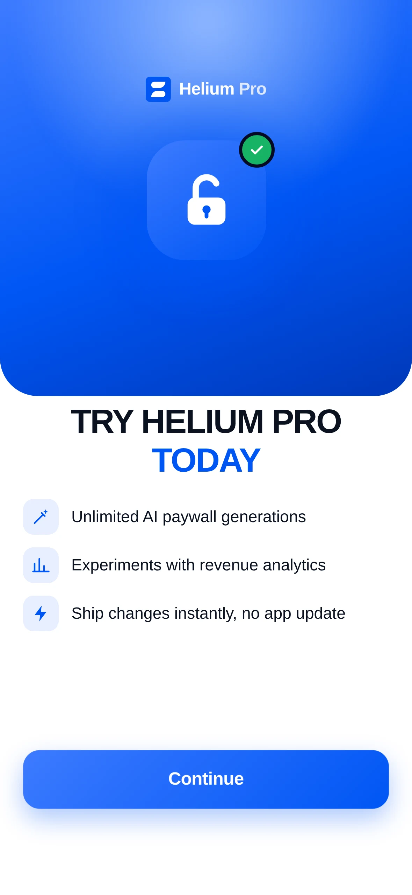
          </Frame>
        </Tab>
        <Tab title="Reminder">
          <Frame>
            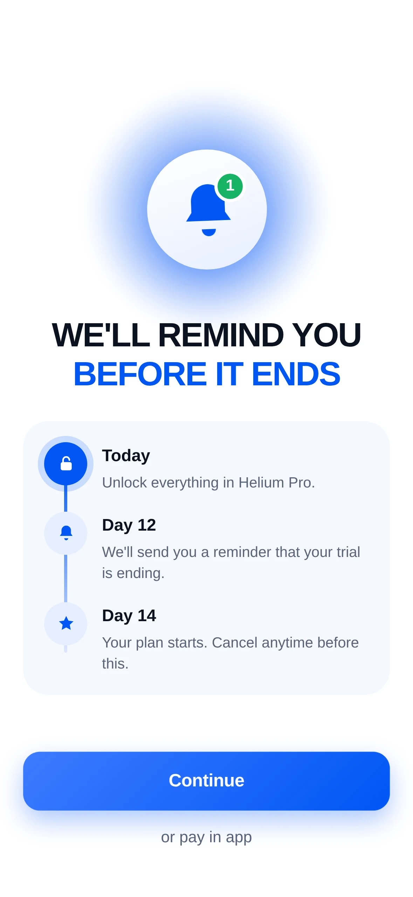
          </Frame>
        </Tab>
        <Tab title="In-app">
          <Frame>
            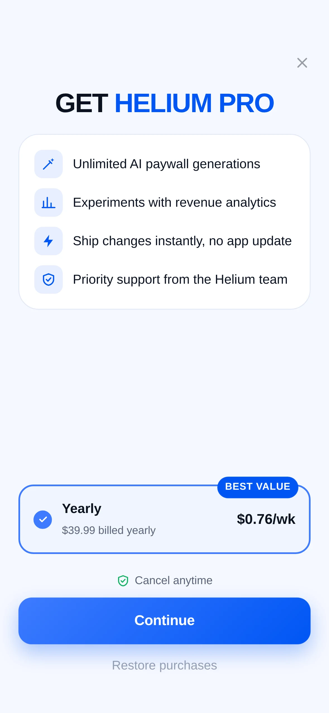
          </Frame>
        </Tab>
        <Tab title="Second offer">
          <Frame>
            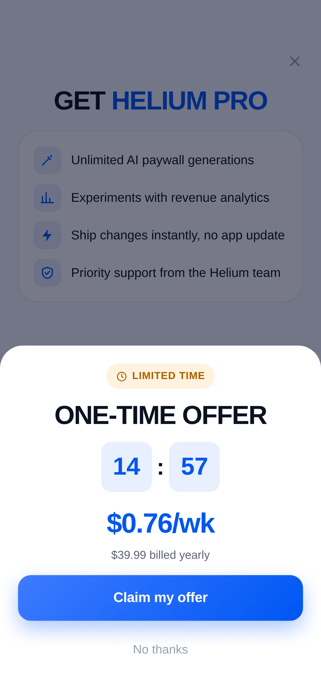
          </Frame>
        </Tab>
        <Tab title="Web">
          <Frame>
            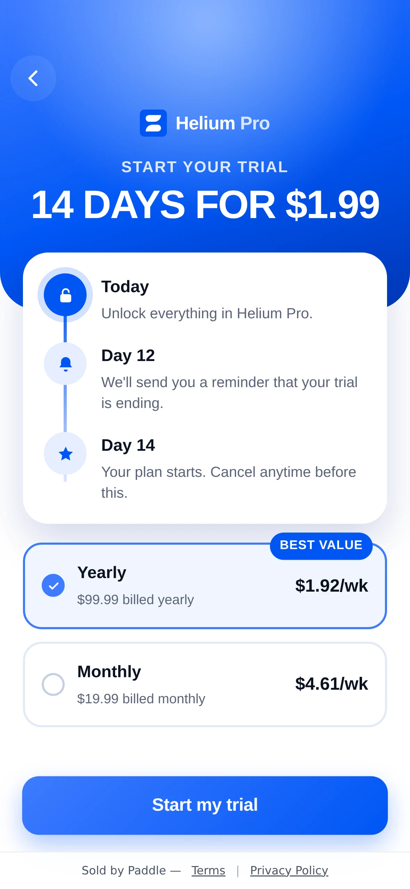
          </Frame>
        </Tab>
      </Tabs>

      **Notice:** the alternative offer appears as a bottom sheet over the familiar plan page. It concentrates attention on one offer and one CTA, while retaining **“No thanks.”**

      Use this as a layout idea for the return-without-buying branch; the image does not establish that behavior. Only use the countdown or “one-time” label if a real, enforced expiry or eligibility rule backs it.
    </Accordion>

    Test success, dismissal, payment failure, and a delayed entitlement update. See the [App2Web testing guide](/guides/paddle-onboarding-guide#7-test-everything).
  </Accordion>
</AccordionGroup>

## Increase your conversion rate

Start with the **web paywall**: it’s the last opportunity to explain the offer before the payment sheet.

<AccordionGroup>
  <Accordion title="Lead with the trial or the benefit">
    Make the main promise easy to read: **“Try it free for 7 days”** or one specific benefit. Follow it with a short supporting line, the selected plan, and one purchase CTA.

    Keep the full post-trial charge, billing date or timing, and automatic-renewal cadence clearly visible. Use **“No payment due today”** only when that is true.
  </Accordion>

  <Accordion title="Make the price easy to understand">
    Test a monthly or weekly equivalent alongside the actual billed amount: **“About $5/month, billed $59.99 annually.”** Derive both from the product data and label approximations honestly.

    Explain savings against a real comparison plan. Avoid repeating competing price blocks, but retain billing disclosures wherever needed. On IAP screens, follow Apple’s requirements for the prominence of the actual charge.

    <Accordion title="Example: make the price feel concrete">
      <Tabs>
        <Tab title="Overview">
      <Frame>
        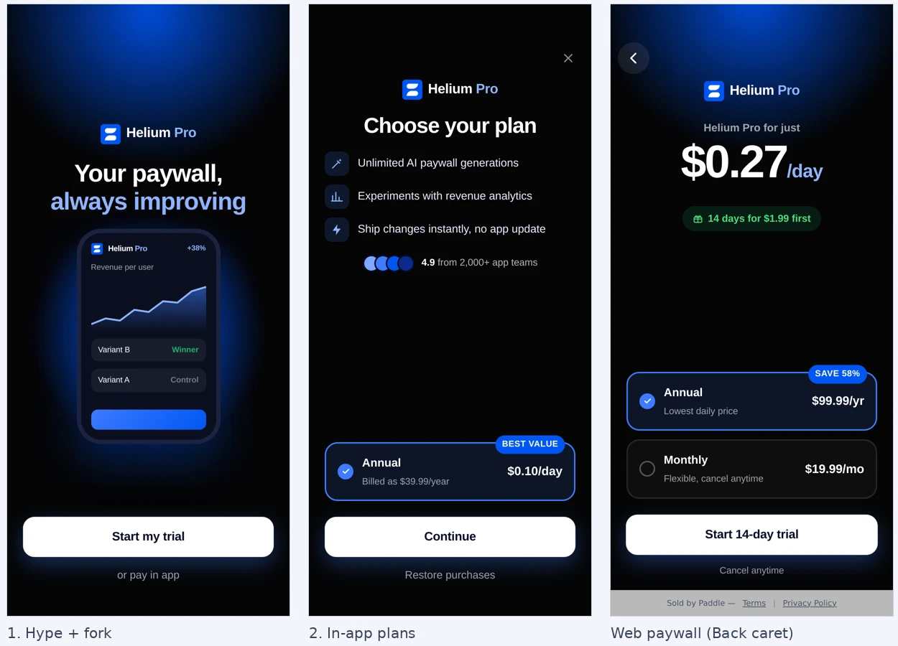
      </Frame>
        </Tab>
        <Tab title="Intro">
          <Frame>
            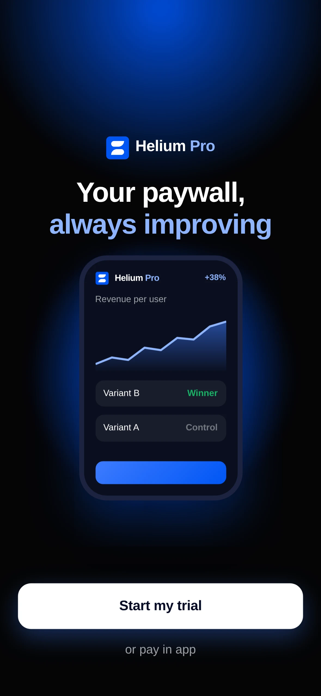
          </Frame>
        </Tab>
        <Tab title="In-app">
          <Frame>
            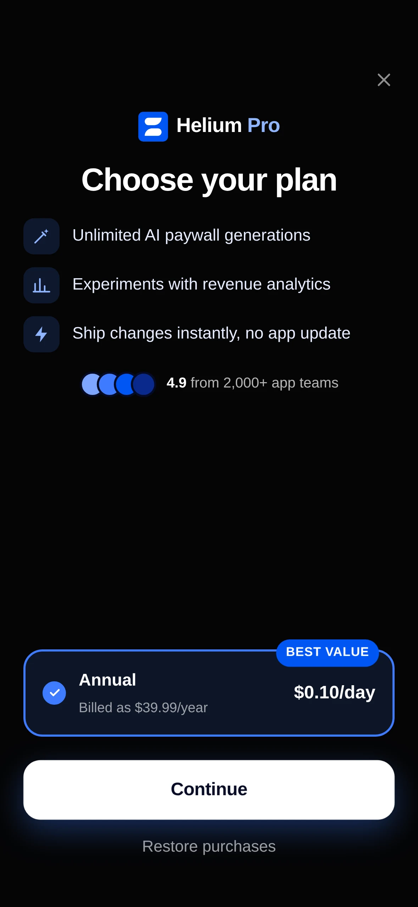
          </Frame>
        </Tab>
        <Tab title="Web">
          <Frame>
            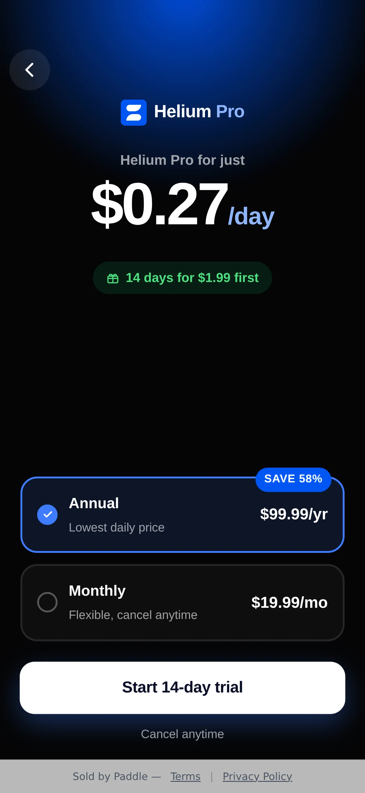
          </Frame>
        </Tab>
      </Tabs>

      **Notice:** the web page makes the daily equivalent the headline, puts the introductory offer in a small badge, and keeps the annual and monthly cards below.

      Test the framing—not a smaller-looking number alone. The actual annual charge must remain clear, and every equivalent must match it. Do not reuse the sample amounts without recalculating them.
    </Accordion>
  </Accordion>

  <Accordion title="Cut the copy and the number of choices">
    Try one headline, one benefit line, one recommended plan, and one CTA. Put additional plans behind **“View all plans.”** Start by testing one or two purchase options instead of a long menu.

    Preselect the intended plan so the purchase CTA works on the first tap. Keep product selection and purchase distinct; changing a plan should not charge the user.
  </Accordion>

  <Accordion title="Test a trial toggle on the web paywall">
    For example: **ON = annual with a trial; OFF = monthly without a trial.** Update the selected product, price, billing terms, and CTA together.

    Explain that the toggle also changes the plan length. Don’t label it only “free trial” if it silently switches monthly to annual billing.
  </Accordion>

  <Accordion title="Keep the browser experience familiar">
    Match the app’s colors, logo, art, plan names, and promise. Keep the offer selected during the handoff. Remove App Store-specific instructions from the web page, such as “Cancel in the App Store.”

    Use a clear Back control and keep required billing, merchant, privacy, and terms information accessible. Avoid duplicate legal rows when the checkout provider already supplies the required links.
  </Accordion>

  <Accordion title="Use motion to direct attention">
    Try a short fade and slight rise for the main card, with a small stagger between elements. Test a subtle CTA shimmer or pulse, or animate the trial/savings badge.

    Pick one or two focal points. Respect reduced-motion settings, keep the page responsive, and don’t delay or obscure the exit control.
  </Accordion>

  <Accordion title="Make the small-screen version excellent">
    Leave room for the browser bars, safe areas, and Paddle’s footer—including inside plan-selection sheets. Make the main CTA visible without scrolling where possible.

    Check small and large phones: no clipping, sideways scroll, covered buttons, or unreadable billing terms. Keep images light so the first screen loads quickly.
  </Accordion>
</AccordionGroup>

## Give web checkout a second try

<AccordionGroup>
  <Accordion title="Show another web paywall when the Apple Pay sheet closes">
    **Helium can show a different paywall in the user’s browser when they close the Apple Pay payment sheet without buying.** Ask your Helium team to configure the web second-try flow for your paywall.

    Try a simpler explanation, a different plan length, or a genuine alternative offer. Keep the new price and renewal terms clear, and let the user leave easily.

    This is different from the in-app return experiment: the user is still in the browser. Don’t show a second offer after a successful payment or trap users in repeated offers.

    **Measure:** additional paid purchases recovered, take-home revenue, and refunds—not just second-page clicks.
  </Accordion>
</AccordionGroup>

## Improve the whole flow

<AccordionGroup>
  <Accordion title="Reassure users about the trial reminder">
    Repeat the reminder promise at useful moments: the trial intro, reminder page, and confirmation. Say when you’ll remind them and use a delivery channel you actually support.

    Only promise a reminder if it is implemented. Explain any notification permission or email requirement; a reminder is not automatic cancellation.
  </Accordion>

  <Accordion title="Add useful steps before the paywall">
    Test one or two short pages: a trial timeline, reminder, personalized benefit, or real social proof. Keep the CTA in a consistent position so the next step feels familiar.

    Each step should earn its place. Track drop-off per page and total conversion, not just the number of taps.

    <Accordion title="Example: sell with social proof before showing plans">
      <Tabs>
        <Tab title="Overview">
      <Frame>
        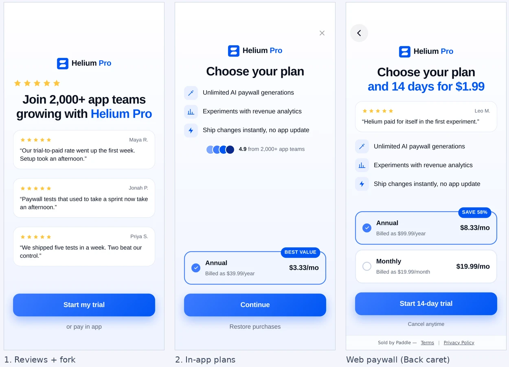
      </Frame>
        </Tab>
        <Tab title="Intro">
          <Frame>
            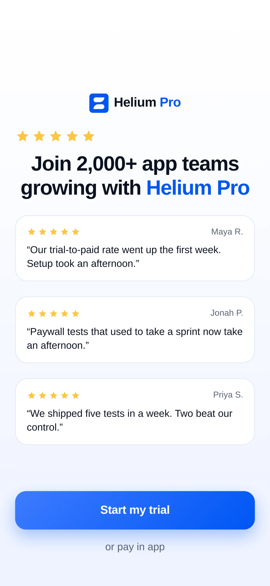
          </Frame>
        </Tab>
        <Tab title="In-app">
          <Frame>
            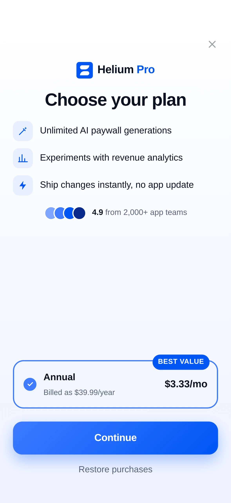
          </Frame>
        </Tab>
        <Tab title="Web">
          <Frame>
            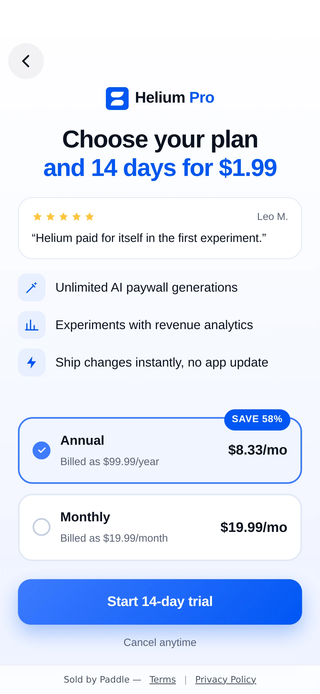
          </Frame>
        </Tab>
      </Tabs>

      **Notice:** the introduction leads with a concise adoption claim and three short review cards. The plan pages keep a smaller proof element close to the benefits, then give the bottom of the screen to price and CTA.

      Try this when hesitation is about trust rather than understanding the product. Use real, permissioned reviews and substantiated claims; the template’s testimonials and numbers are placeholders.
    </Accordion>
  </Accordion>

  <Accordion title="Give people a reason to look before they leave">
    Test an image, product demonstration, or short animation near the top of the paywall. It can draw attention to the offer before someone instinctively taps close.

    Pair this with a quick entrance animation for the main content. Keep close/back controls visible and usable; earn attention with the content.
  </Accordion>
</AccordionGroup>

## Pick a winner

**Your north star is proceeds per user:** total take-home revenue across IAP and web, divided by everyone exposed to the variant—including people who don’t buy.

**Start with conversion rate** for an early read. But an App2Web paywall with a lower conversion rate can still earn more if it moves more purchases to web or gets more people onto higher-value plans.

**Once trials convert and enough paid data comes in, compare proceeds per user.** Use the same observation period for each variant and account for fees, taxes, and refunds. Pick the variant that earns more per exposed user, not simply the one with the most purchases or the highest web share.

Follow the [rollout guide](/guides/paddle-onboarding-guide#8-roll-out-your-experiment) for the initial audience and 24-hour health check.
