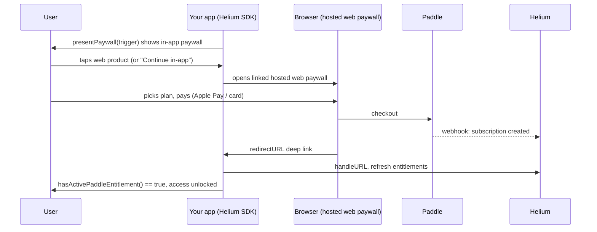

App2Web adds a web checkout path to a Helium paywall. The user taps a web product on your in-app paywall, Helium opens a hosted web paywall in the browser, the purchase completes with Paddle, and the user returns to your app with the entitlement granted. The same paywall keeps selling your App Store products, so nothing changes for users who aren't eligible or who prefer to pay in-app.

## Why

- **Keep the store commission.** A web purchase costs the payment processor's fee instead of the App Store's 15–30%.
- **No separate product.** It's a second purchase action on the paywall you already have, with a **Continue in-app** path next to it.
- **Measure it.** Run the in-app paywall vs. the App2Web version as a normal Helium experiment, and evaluate on take-home ARPU rather than conversion alone. See [How should I evaluate an App2Web experiment?](/guides/app2web-faq#experiment-results).

## Who can use it

| | |
|---|---|
| Platform | iOS. Web-checkout APIs in the React Native and Flutter SDKs are safe no-ops on Android. |
| Storefront | US App Store, US device region and US network location. Everyone else gets the in-app path. |
| Payment provider | **Paddle** (merchant of record: handles tax, Apple Pay, customer portal). Already on Stripe? You can bring your own Stripe account instead; see the [Stripe guide](/guides/stripe-onboarding-guide). |
| Language | Hosted web paywalls currently support one language. |
| SDK | iOS 4.6.0+, `expo-helium` 3.4.13+, `@tryheliumai/paywall-sdk-react-native` 3.1.2+, `helium_flutter` 3.3.8+. On-device previews need the versions listed in [Paywall previews](/guides/paywall-previews#app2web-previews). |

Helium's **App2Web eligibility** audience preset captures these rules, and also keeps users likely to have Apple Pay billing issues on the in-app path.

## How the flow works

1. **Products**: prices are created in Paddle and synced to Helium next to your store products.
2. **Paywalls**: an in-app paywall with a purchase action on a web product, linked to a hosted web paywall built in the same editor. Only the in-app paywall is targeted in workflows; the web paywall opens from it.
3. **SDK**: `enableExternalWebCheckout` before `initialize`, a user ID, and a deep link handler for the return. The code is in the **Web checkout (App2Web)** section of each SDK quickstart.
4. **Entitlements and revenue**: Paddle webhooks (configured automatically) tell Helium, and RevenueCat if you use it, about the purchase, so access unlocks when the user returns.

## Set up

<Steps>
  <Step title="Connect Paddle and sync products">
    [Paddle onboarding, steps 1–3](/guides/paddle-onboarding-guide): account, payment link, connect to Helium, sync.
  </Step>
  <Step title="Build the paywall pair">
    [Build an App2Web paywall](/guides/build-app2web-paywall): add the web product and purchase action, create and link the hosted web paywall, publish both.
  </Step>
  <Step title="Add the SDK calls">
    [iOS](/sdk/quickstart-ios#web-checkout-app2web) · [React Native / Expo](/sdk/quickstart-react-native#web-checkout-app2web) · [Flutter](/sdk/quickstart-flutter#web-checkout-app2web). Then [configure entitlements](/guides/paddle-onboarding-guide#6-configure-your-entitlements).
  </Step>
  <Step title="Test">
    [App2Web previews](/guides/app2web-previews) on device with simulated or real purchases, then a real purchase through a real trigger.
  </Step>
  <Step title="Roll out">
    [Go-live checklist](/guides/app2web-go-live-checklist), then a small-audience 50/50 experiment vs. your current paywall per [Roll out your experiment](/guides/paddle-onboarding-guide#8-roll-out-your-experiment).
  </Step>
</Steps>

Have a question that isn't covered? See the [App2Web FAQ](/guides/app2web-faq).
